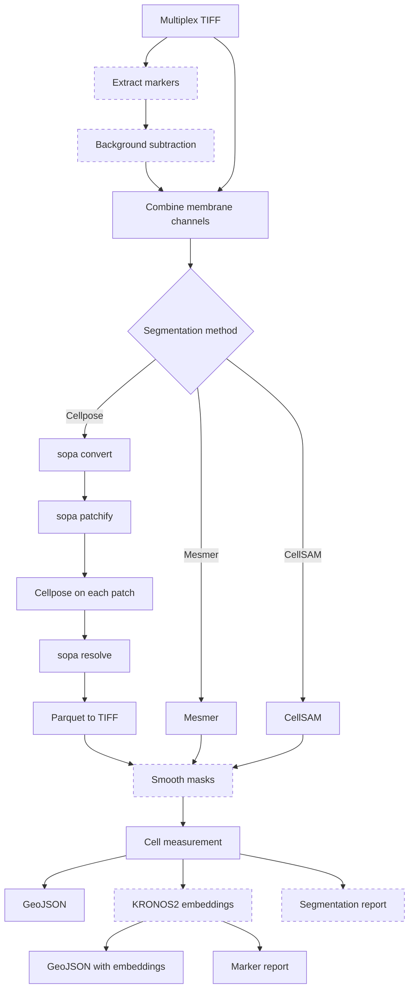

<h1>
  <picture>
    <source media="(prefers-color-scheme: dark)" srcset="assets/wehi-soda-hub-sp_segment_logo_dark.png">
    
  </picture>
</h1>

[](https://github.com/WEHI-SODA-Hub/sp_segment/actions/workflows/ci.yml)
[](https://github.com/WEHI-SODA-Hub/sp_segment/actions/workflows/linting.yml)
[](https://wehi-soda-hub.github.io/sp_segment/)
[](https://doi.org/10.5281/zenodo.17103183)
[](https://www.nf-test.com)

[](https://www.nextflow.io/)
[](https://github.com/nf-core/tools/releases/tag/3.3.2)
[](https://www.docker.com/)
[](https://sylabs.io/docs/)
[](https://cloud.seqera.io/launch?pipeline=https://github.com/WEHI-SODA-Hub/sp_segment)

## Introduction

**WEHI-SODA-Hub/sp_segment** is a Nextflow pipeline that segments cells in
multiplex spatial proteomics images from COMET, MIBI and OPAL. For each image it
can subtract background (COMET only), segment whole cells and optionally nuclei
with Cellpose, Mesmer or CellSAM, measure shape and per-channel intensity for
each cell, add KRONOS2 embeddings, and write a QC report. The cells and their
measurements are written to a GeoJSON file that opens in QuPath.

**Documentation: <https://wehi-soda-hub.github.io/sp_segment/>** (also readable
in [`docs/`](docs/README.md)).



Dashed boxes are optional steps. Nuclear segmentation is optional for every
method and is off by default.

## Quick start

Requirements: Nextflow 24.04.2 or later, and Apptainer, Singularity or Docker.
Cellpose, CellSAM and KRONOS2 need a GPU.

Test your setup:

```bash
nextflow run WEHI-SODA-Hub/sp_segment -profile test,singularity --outdir results
```

Write a samplesheet with one row per image:

```csv
sample,run_backsub,run_cellpose,tiff,nuclear_channel,membrane_channels
slide1,true,true,/data/slide1.ome.tiff,DAPI,CD45:Pan-Cytokeratin
```

Run the pipeline:

```bash
nextflow run WEHI-SODA-Hub/sp_segment \
    -r 0.5.0 \
    -profile singularity \
    --input samplesheet.csv \
    --outdir results
```

Set parameters on the command line or with `-params-file`, not in a `-c`
config file. Mesmer needs a DeepCell token:
`nextflow secrets set DEEPCELL_ACCESS_TOKEN <token>`.

Next steps:

- [Install and test](docs/getting-started.md)
- [Running at WEHI](docs/wehi.md) (Milton and Seqera Platform)
- [Samplesheet](docs/reference/samplesheet.md) and
  [parameters](docs/reference/parameters.md)
- [Outputs](docs/output.md)
- [Troubleshooting](docs/troubleshooting.md)

## Tools

- [Background_subtraction](https://github.com/SchapiroLabor/Background_subtraction): COMET background subtraction
- [Cellpose](https://www.cellpose.org) through [sopa](https://github.com/gustaveroussy/sopa): patch-based segmentation
- [MesmerSegmentation](https://github.com/WEHI-SODA-Hub/mesmersegmentation): Mesmer segmentation
- [CellSAM](https://github.com/vanvalenlab/cellSAM): foundation-model segmentation
- [cellmeasurement-py](https://github.com/WEHI-SODA-Hub/cellmeasurement-py): nucleus-to-cell matching and measurements
- [KRONOS2](https://huggingface.co/MahmoodLab/KRONOS2): per-cell embeddings
- [spatialVis](https://github.com/WEHI-SODA-Hub/spatialVis): segmentation report plots

## Credits

WEHI-SODA-Hub/sp_segment was originally written by the WEHI SODA Hub.

We thank the following people for their extensive assistance in the development
of this pipeline:

- Michael McKay (@mikemcka)
- Emma Watson

## Contributions and support

See the [contributing guide](docs/developer/contributing.md). Report problems in
the [issue tracker](https://github.com/WEHI-SODA-Hub/sp_segment/issues).

## Citations

If you use WEHI-SODA-Hub/sp_segment for your analysis, please cite it using the
following DOI:
[10.5281/zenodo.17103183](https://doi.org/10.5281/zenodo.17103183)

References for the tools used by the pipeline are in
[`CITATIONS.md`](CITATIONS.md).

This pipeline was created using the `nf-core` template. You can cite the
`nf-core` publication as follows:

> **The nf-core framework for community-curated bioinformatics pipelines.**
>
> Philip Ewels, Alexander Peltzer, Sven Fillinger, Harshil Patel, Johannes Alneberg, Andreas Wilm, Maxime Ulysse Garcia, Paolo Di Tommaso & Sven Nahnsen.
>
> _Nat Biotechnol._ 2020 Feb 13. doi: [10.1038/s41587-020-0439-x](https://dx.doi.org/10.1038/s41587-020-0439-x).
