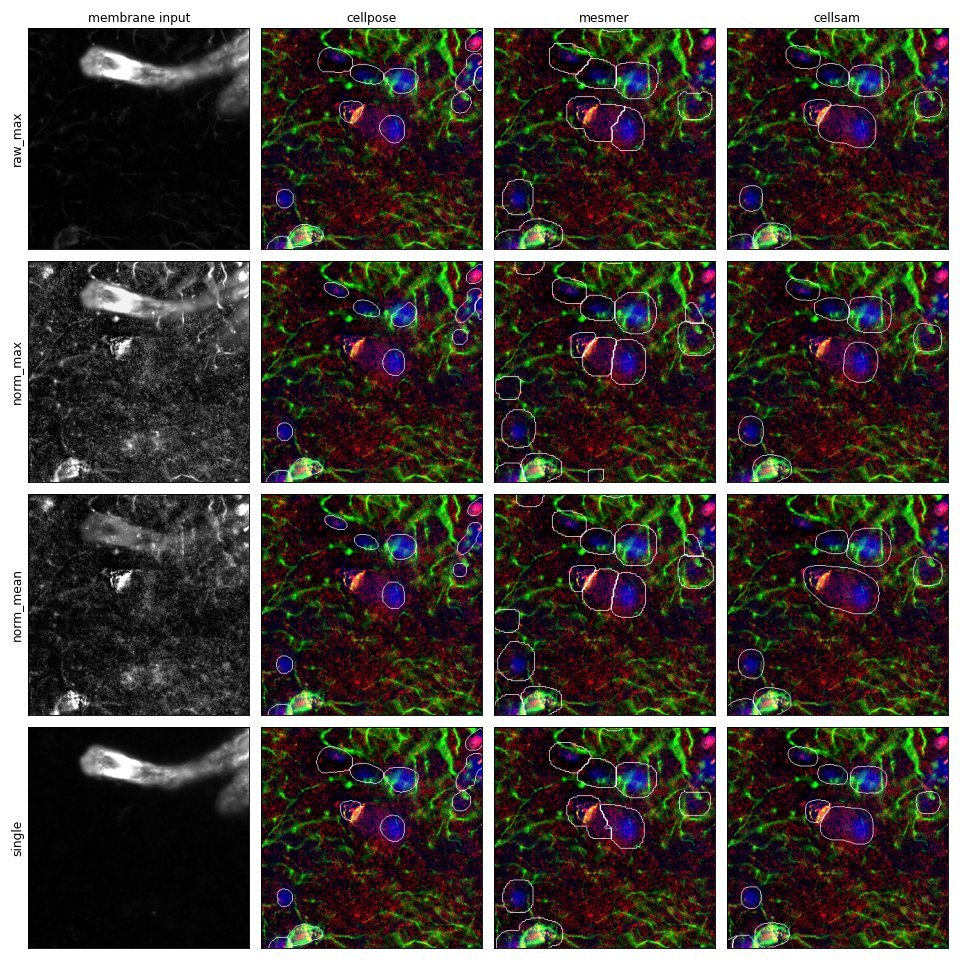

# Combining membrane channels

When `membrane_channels` lists more than one channel, the pipeline combines
them into one membrane channel before segmentation. This page describes how,
and records a test of whether rescaling each channel before combining gives
better segmentation.

## What the pipeline does

`COMBINECHANNELS` takes the per-pixel maximum of the listed channels, using
their raw intensities. Cellpose and CellSAM receive this combined channel.
Mesmer combines the channels the same way inside `mesmer-segment`.

Each segmenter then rescales the channel it receives. Cellpose rescales to the
1st and 99th percentiles; Mesmer and CellSAM also apply contrast enhancement
(CLAHE). This rescaling happens after the combination.

## The concern

Channels have different intensity ranges, set by exposure time, antibody and
dilution. In a raw maximum, the channel with the highest values wins most
pixels. A dim marker can lose everywhere, including in the cells it marks.

Contrast of marker-only pixels in each membrane input, measured on the test
image below. For each marker, the pixels where only that marker is bright are
compared with the marker's dim pixels; contrast is the difference in means
divided by the standard deviation of the dim pixels. The value does not change
under a linear rescale, so the segmenters' own percentile rescaling does not
change it.

| Marker      | Pixels | Raw max | Rescaled max | Rescaled mean | Marker alone |
| ----------- | ------ | ------- | ------------ | ------------- | ------------ |
| CD45        | 1378   | 0.50    | 11.59        | 9.06          | 7.31         |
| MHCII       | 439    | 1.42    | 9.75         | 9.22          | 10.67        |
| Iba1        | 490    | 3.60    | 9.70         | 8.87          | 11.40        |
| GFAP        | 4576   | 25.56   | 10.79        | 8.06          | 21.28        |
| Integrin β1 | 6501   | 100.70  | 10.12        | 6.85          | 215.26       |

In the raw maximum, a cell marked only by CD45 is 0.5 background standard
deviations above background, which is within the noise. Rescaling each channel
first gives every marker a contrast of about 7 to 12, but lowers the contrast
of the brightest markers.

## Test: does rescaling first give better segmentation?

### Data

- One 1024 × 1024 pixel crop of a background-subtracted COMET image of brain
  tissue, 0.28 µm/pixel, 42 channels.
- Nuclear channel: `DAPI`.
- Membrane channels: `VCW_CD45`, `VCW_MHCII`, `VCW_Iba1_AIF1`,
  `VCW_GFAP_diluted`, `VCW_Integrin_b1`.

### Membrane inputs

| Name          | Membrane channel                                                                                 |
| ------------- | ------------------------------------------------------------------------------------------------ |
| Raw max       | per-pixel maximum of the raw channels (the pipeline's method)                                    |
| Rescaled max  | each channel rescaled (median → 0, 99.5th percentile → 1, values below 0 set to 0), then maximum |
| Rescaled mean | the same rescaling, then the per-pixel mean                                                      |
| Integrin β1   | `VCW_Integrin_b1` only                                                                           |

Each input was segmented by Cellpose (`cpsam_v2`), Mesmer and CellSAM with the
pipeline defaults (`use_whole_cell_only = true`, `cellpose_min_area = 100`,
`cellsam_min_area = 200`). The final masks from `cellmeasurement/` were scored.

### Results

| Segmenter | Input         | Cells | Median area (µm²) | Nuclei inside a cell |
| --------- | ------------- | ----- | ----------------- | -------------------- |
| Cellpose  | Raw max       | 92    | 61.0              | 61.4%                |
| Cellpose  | Rescaled max  | 81    | 56.1              | 56.2%                |
| Cellpose  | Rescaled mean | 77    | 56.8              | 50.3%                |
| Cellpose  | Integrin β1   | 89    | 64.7              | 59.5%                |
| Mesmer    | Raw max       | 104   | 141.4             | 66.0%                |
| Mesmer    | Rescaled max  | 125   | 130.3             | 76.5%                |
| Mesmer    | Rescaled mean | 114   | 142.2             | 75.2%                |
| Mesmer    | Integrin β1   | 94    | 140.9             | 66.0%                |
| CellSAM   | Raw max       | 92    | 107.5             | 64.7%                |
| CellSAM   | Rescaled max  | 75    | 143.3             | 64.1%                |
| CellSAM   | Rescaled mean | 72    | 155.2             | 64.7%                |
| CellSAM   | Integrin β1   | 95    | 84.8              | 67.3%                |

"Nuclei inside a cell" is the share of 153 nuclei, found by
Laplacian-of-Gaussian blob detection on DAPI, whose centre falls inside a
segmented cell.

### Observations

- The raw maximum is close to Integrin β1 alone. Integrin β1 has the highest
  values, so it wins most pixels, and the segmentations from the two inputs are
  similar.
- Rescaling raises the background noise and the autofluorescent granules,
  which appear in every channel in this tissue. Mesmer and CellSAM draw larger
  outlines around these granules (median area up to 155 µm²).
- Rescaling helped Mesmer (125 cells and 76.5% of nuclei inside a cell, against
  104 and 66.0%), and made Cellpose and CellSAM find fewer cells.
- Every combination left a third or more of the nuclei outside a cell. None of
  the five markers outlines most cells, and that limits all four inputs more
  than the combination method does.

### Conclusion

On this image, rescaling each channel before combining did not give better
segmentation overall, so the pipeline keeps the raw per-pixel maximum.

Limitations:

- One image, one tissue type (brain, with strong autofluorescence) and one
  panel without a membrane marker present on most cells.
- No ground-truth segmentation. Cell counts and nucleus capture are proxies.
- Per-marker measures (share of each marker's signal inside cells) were also
  computed, but CD45 was above the positivity threshold on about 12% of the
  image, which is mostly diffuse background in this tissue, so they are not
  reported here. They are in `experiments/membrane_combine/results_run5_crop.csv`.

A panel that combines markers for different cell types with clear membrane
staining (for example CD45 with pan-cytokeratin in a tumour) may behave
differently and has not been tested.

## Choosing membrane channels

- A membrane marker present on most cells, such as Na⁺/K⁺-ATPase,
  β-catenin or HLA class I, outlines more cells than a mix of cell-type
  markers.
- Each extra channel in a maximum can only raise the background. List the
  channels that outline cells, not every marker in the panel.
- Check the combined image in `combinechannels/<sample>_combined_channels.tiff`
  before running a cohort. If one marker dominates it, the other listed markers
  contribute little.

## Repeating the test

The scripts are in `experiments/membrane_combine/`:

1. `make_inputs.py --tiff <image> --outdir <dir>` writes the four membrane
   inputs as 2-channel OME-TIFFs and a samplesheet with one row per input and
   segmenter.
2. Run the pipeline on that samplesheet with `--deepcell_cache_dir` set.
3. `analyse.py --tiff <image> --results <outdir> --inputs <dir> --out <dir>`
   writes `scores.csv`, `contrast.csv` and `overlays.png`.

Edit `MARKERS`, `SINGLE` and `NUCLEAR` in `make_inputs.py` for another panel.
