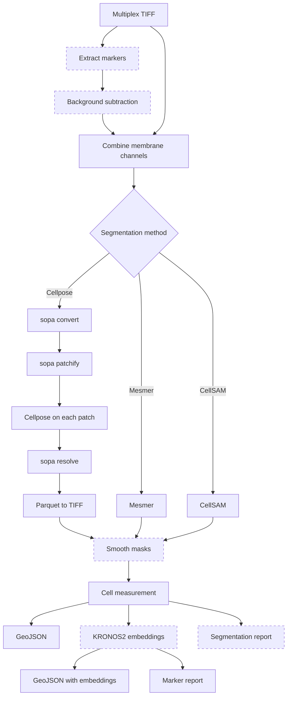

# sp_segment

sp_segment is a Nextflow pipeline that segments cells in multiplex spatial
proteomics images from COMET, MIBI and OPAL. It writes one GeoJSON file per
image that contains every cell outline and its measurements. You can open the
GeoJSON in QuPath.

For each image, the pipeline can:

- subtract background (COMET only)
- segment whole cells, and optionally nuclei, with Cellpose, Mesmer or CellSAM
- smooth the label masks
- measure shape and per-channel intensity for each cell compartment
- add a 768-value KRONOS2 embedding to every cell
- write an HTML QC report

## Workflow

Dashed boxes are optional steps. Nuclear segmentation is optional for every
method and is off by default (`use_whole_cell_only = true`).

## Supported inputs

| Input                | Background subtraction | Cellpose | Mesmer | CellSAM |
| -------------------- | ---------------------- | -------- | ------ | ------- |
| COMET OME-TIFF       | yes                    | yes      | yes    | yes     |
| OPAL OME-TIFF        | no                     | yes      | yes    | yes     |
| MIBI multi-page TIFF | no                     | no       | yes    | yes     |

Cellpose requires an OME-TIFF, because sopa converts the image with
`technology = ome_tif`. See
[Choose a segmentation method](how-to/choose-segmenter.md).

## Where to start

- New to the pipeline: [Install and test](getting-started.md).
- At WEHI: [Running at WEHI](wehi.md).
- Writing a samplesheet: [Samplesheet](reference/samplesheet.md).
- Looking up a parameter: [Parameters](reference/parameters.md).
- A run failed: [Troubleshooting](troubleshooting.md).

## Citation

If you use sp_segment, cite
[10.5281/zenodo.17103183](https://doi.org/10.5281/zenodo.17103183) and the
tools listed in [Citations](citations.md).
